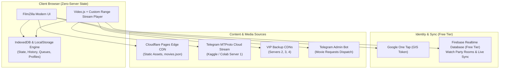

# 🎬 FilmZilla Ultimate Master Blueprint: 12 World-Class Streaming Platform Features

> **Vision**: Transform FilmZilla into a world-class, human-psychology-driven streaming ecosystem matching and surpassing Netflix, Prime Video, Twitch, TikTok, and YouTube — tailored with zero server costs on Cloudflare Pages and Telegram Cloud.

---

## 📑 Table of Contents
1. [Architectural Overview & Psychological Pillars](#architectural-overview--psychological-pillars)
2. [Global UI/UX Placement Matrix](#global-uiux-placement-matrix)
3. [Deep-Dive Specifications for All 12 Features](#deep-dive-specifications-for-all-12-features)
   - [Feature 1: 👤 Google One Tap Auto-Profile & Identity Engine](#feature-1--google-one-tap-auto-profile--identity-engine)
   - [Feature 2: ⏯️ Continue Watching & Instant Auto-Resume Shelf](#feature-2-️-continue-watching--instant-auto-resume-shelf)
   - [Feature 3: 📜 Chronological Watch History & Timeline Manager](#feature-3--chronological-watch-history--timeline-manager)
   - [Feature 4: ⏱️ One-Click Watch Later Shelf & Quick Queue](#feature-4-️-one-click-watch-later-shelf--quick-queue)
   - [Feature 5: ❤️ My Favorites & Custom Watchlist Collection](#feature-5-️-my-favorites--custom-watchlist-collection)
   - [Feature 6: 🎯 "For You" Algorithmic Recommendation Engine](#feature-6--for-you-algorithmic-recommendation-engine)
   - [Feature 7: 🎲 "Surprise Me / Feeling Lucky" Cinema Roulette](#feature-7--surprise-me--feeling-lucky-cinema-roulette)
   - [Feature 8: 🔔 "Release Radar" & Smart Print Upgrade Alerts](#feature-8--release-radar--smart-print-upgrade-alerts)
   - [Feature 9: 🖼️ Native Picture-in-Picture (PiP) Multitasking Theater](#feature-9-️-native-picture-in-picture-pip-multitasking-theater)
   - [Feature 10: 🔥 Live Quick Emoji Reaction Heat-Meter](#feature-10--live-quick-emoji-reaction-heat-meter)
   - [Feature 11: 📥 "Request a Movie" Direct Telegram Dispatcher](#feature-11--request-a-movie-direct-telegram-dispatcher)
   - [Feature 12: 👥 Synchronized "Watch Party" Live Social Cinema Room](#feature-12--synchronized-watch-party-live-social-cinema-room)
4. [File & Code Structure Modifications](#file--code-structure-modifications)
5. [User Review Required & Design Decisions](#user-review-required)
6. [Open Questions](#open-questions)
7. [Verification & Quality Assurance Plan](#verification-plan)

---

## 1. Architectural Overview & Psychological Pillars



### 🧠 The 4 Psychological Pillars of Retention
1. **Zero-Friction Immersion (The TikTok / Netflix Principle)**:
   - Users should never fill out registration forms or remember passwords. Google One Tap gives instant identity with zero clicks or one tap. Auto-Resume puts them back in the action within 100 milliseconds.
2. **Social Validation & Co-Presence (The Twitch / WhatsApp Principle)**:
   - People enjoy entertainment more when shared. The Watch Party and Live Emoji Floats create a communal atmosphere where users feel connected to friends or a living audience.
3. **Endowment Effect & Investment (The Spotify / Letterboxd Principle)**:
   - Once a user saves Favorites, accumulates Watch History, and sets Watch Later reminders, the website becomes *theirs*. Switching costs increase and retention skyrockets.
4. **Instant Gratification & Anti-Fatigue (The Tinder / Reels Principle)**:
   - "Choice Paralysis" kills streaming sessions. The "Surprise Me" roulette and "Because you watched..." shelves immediately solve "What should I watch tonight?" in under 2 seconds.

---

## 2. Global UI/UX Placement Matrix

Where each feature lives across Desktop and Mobile form factors:

| Feature | Primary Location | Mobile Location | Micro-Interaction / Trigger |
| :--- | :--- | :--- | :--- |
| **1. Google Profile** | Top Header (Right flank, next to search) | Top Header + Mobile Drawer profile tile | Slide-in One Tap card, avatar with dropdown |
| **2. Continue Watching** | Home Page Row 1 (Immediately below Hero Deck) | Home Page Row 1 (Horizontal swipe carousel) | Progress bar on card, "Resume at MM:SS" |
| **3. Watch History** | Header Dropdown & Dedicated `/history.html` modal | Mobile Nav menu & Profile drawer | Timestamped cards, "Clear All" with undo |
| **4. Watch Later** | Card Hover Quick-Action & Header Queue icon | Poster Long-Press / Ribbon & Profile tab | Clock icon toggle, animated count badge `+1` |
| **5. My Favorites** | Card Heart button & Dedicated "My List" row | Poster Heart badge & Mobile Nav bar | Heart pop animation with micro-haptic burst |
| **6. "For You" Shelf** | Home Page Section (Dynamic position) | Home Page Section with personalized badge | "Because you watched [Title]" dynamic pill |
| **7. Surprise Me** | Floating Glass Dice / Header Action button | Floating Action Button (FAB) bottom right | 3D Rolling Dice modal + cinematic curtain reveal |
| **8. Release Radar** | Movie Details poster badge + Header Bell icon | Bell icon on Header + in-app alert pill | "Remind Me 🔔" toggle on Cam/Upcoming films |
| **9. PiP Mode** | Player Control Bar (Right side, next to Fullscreen) | Native Floating PiP button + auto-trigger on tab switch | Smooth float out to screen corner |
| **10. Quick Reactions** | Under Player Container (Directly above details) | Sticky reaction strip beneath active player | Floating upward emojis (🔥, 🤯, 🍿, 😴) |
| **11. Request Movie** | Search overlay empty-state & Footer action | Search "No Results" banner & Menu item | Instant modal form -> Telegram Admin Channel |
| **12. Watch Party** | Player Action Bar ("👥 Watch Party" button) | Under Player Action Strip | Generates shareable WhatsApp/Telegram link & Glass Room |

---

## 3. Deep-Dive Specifications for All 12 Features

---

### Feature 1: 👤 Google One Tap Auto-Profile & Identity Engine

```
┌─────────────────────────────────────────────────────────────┐
│  [Logo] FilmZilla    Home  Movies  Series  Genre           │
│                                   [Search]  [Hello, Kasun ▾] │
│                                             [Avatar Img]    │
└─────────────────────────────────────────────────────────────┘
                                  │
                                  ▼ Dropdown Menu
                         ┌───────────────────────────┐
                         │ 👤 Kasun Perera           │
                         │    kasun@gmail.com        │
                         ├───────────────────────────┤
                         │ ⏯️ Continue Watching (2)  │
                         │ ❤️ My Favorites (8)       │
                         │ ⏱️ Watch Later (4)        │
                         │ 📜 Watch History          │
                         ├───────────────────────────┤
                         │ 🚪 Sign Out               │
                         └───────────────────────────┘
```

* **Visual Architecture**:
  - Unauthenticated state: Shows sleek `"Sign In"` button with subtle Google G-logo and pulsing glow.
  - Authenticated state: Replaced by Apple-style liquid glass pill: `[User Profile Pic] Hello, Kasun ▾`.
  - Clicking the pill opens a frosted glass dropdown drawer containing quick access to all user lists.
* **Psychology**:
  - **Zero Friction**: Google One Tap slides in smoothly from top-right. With `auto_select: true`, returning users are logged in automatically without touching a single button.
  - **Ownership**: Seeing their name and photo transforms a generic movie site into a personalized luxury portal.
* **Technical Details**:
  - **Library**: Official Google Identity Services (`https://accounts.google.com/gsi/client`).
  - **Storage**: Client-side JWT credential decoded (`name`, `given_name`, `picture`, `email`, `sub`).
  - **Data Key**: `localStorage.getItem('fz_user_profile')`.
  - **Guest Mode Fallback**: If user cancels or blocks third-party cookies, system creates a local anonymous profile (`"Guest #481"`) so all favorites and history still work locally without Google.

---

### Feature 2: ⏯️ Continue Watching & Instant Auto-Resume Shelf

```
┌──────────────────────────────────────────────────────────────────────────┐
│ ⏯️ CONTINUE WATCHING FOR KASUN                               [Clear]     │
│ ┌──────────────────────┐  ┌──────────────────────┐                       │
│ │ [Movie Backdrop]     │  │ [Movie Backdrop]     │                       │
│ │   ▶ RESUME           │  │   ▶ RESUME           │                       │
│ │ ═══════════░░░░ 68%  │  │ ═════░░░░░░░░ 32%    │                       │
│ │ Interstellar         │  │ Dune: Part Two       │                       │
│ │ 1h 24m remaining     │  │ 2h 10m remaining     │                       │
│ └──────────────────────┘  └──────────────────────┘                       │
└──────────────────────────────────────────────────────────────────────────┘
```

* **Visual Architecture**:
  - Displayed prominently as **Row #1** right below the Hero Banner.
  - 16:9 landscape cards featuring the exact video backdrop.
  - High-contrast red progress bar indicating percentage watched (`currentTime / duration * 100`).
  - Floating badge: `"Episode 4"` (for series) or `"42 min left"`.
  - Hovering card displays an instant `"▶ Resume from 42:15"` button and an `"✕ Remove"` cross.
* **Player Integration**:
  - On `movie.html`, if previous playback position exists (`> 15 seconds` and `< 95% finished`), player automatically jumps to that timestamp upon loading with a toast: *"Resumed at 42:15 [Replay from Start]"*.
* **Technical Details**:
  - **Event Listeners**: Video.js `timeupdate` (throttled every 5 seconds) and `pause`.
  - **Storage Key**: `localStorage.getItem('fz_continue_watching')`:
    ```json
    {
      "tt15239678": {
        "id": "dune-part-two-2024",
        "title": "Dune: Part Two",
        "poster": "https://...",
        "backdrop": "https://...",
        "currentTime": 2534,
        "duration": 9960,
        "percentage": 25.4,
        "lastWatched": 1731805200000,
        "season": 1,
        "episode": 3
      }
    }
    ```
  - Items with `percentage > 95%` are marked finished and automatically moved to History.

---

### Feature 3: 📜 Chronological Watch History & Timeline Manager

* **Visual Architecture**:
  - Accessible via Header Dropdown, Mobile Drawer, or `history.html`.
  - Clean cinematic timeline grouped by: **Today**, **Yesterday**, **This Week**, **Earlier**.
  - Displays watch progress, date watched, quality watched (1080p/720p), and quick actions (Rewatch / Delete entry / Clear all history).
* **Psychology**:
  - Allows users to easily find that movie they enjoyed weeks ago to recommend to friends.
* **Technical Details**:
  - Stores up to 100 recent movies in `fz_watch_history` (IndexedDB / LocalStorage).
  - Searchable by movie title inside the history modal.

---

### Feature 4: ⏱️ One-Click Watch Later Shelf & Quick Queue

* **Visual Architecture**:
  - Hover action on every movie card on Home, Search, and Category pages.
  - Quick Clock Icon (`fa-regular fa-clock` -> `fa-solid fa-clock`).
  - On `movie.html`, a dedicated prominent action button: `[+ Watch Later]`.
  - Header displays a live queue badge: `⏱️ [3]`.
* **Micro-Interaction**:
  - Clicking "Watch Later" plays a subtle soundless liquid bubble animation and increments the header badge with a fly-to-cart particle motion.
* **Storage**: `localStorage.getItem('fz_watch_later')` array of movie IDs with timestamps.

---

### Feature 5: ❤️ My Favorites & Custom Watchlist Collection

```
┌─────────────────────────────────────────────────────────────┐
│ [Poster]                                                    │
│   (❤️ Active / ♡ Inactive)  <-- Top Right Corner of Poster  │
│                                                             │
│ Movie Title (2026)                                          │
└─────────────────────────────────────────────────────────────┘
```

* **Visual Architecture**:
  - Red neon heart button on every movie card and on the movie detail page.
  - Dedicated **"❤️ My Favorites"** section tab on the homepage filter bar.
* **Micro-Interaction**:
  - Clicking Heart triggers a custom CSS micro-heart burst / confetti animation.
* **Sorting & Filtering**:
  - Users can sort their favorites by *Recently Added*, *IMDb Rating*, or *Release Year*.

---

### Feature 6: 🎯 "For You" Algorithmic Recommendation Engine

* **How It Works (Local AI / Heuristic Vector)**:
  - No server-side machine learning needed! Operates 100% on the client side using a genre-frequency weight table.
  - When a user watches or favorites movies, the system tracks affinity:
    - *Watched Action movie = +3 points to Action*
    - *Favorited Sci-Fi movie = +5 points to Sci-Fi*
    - *Finished movie with Director Christopher Nolan = +4 points to Nolan*
  - The engine matches this vector against `data/movies.json` and dynamically generates a personalized shelf:
    - `"🎯 For You: Top Picks in Sci-Fi & Action"`
    - `"Because you watched Interstellar..."`
* **Placement**: Injected on the homepage right after "Trending Now".

---

### Feature 7: 🎲 "Surprise Me / Feeling Lucky" Cinema Roulette

```
┌────────────────────────────────────────────────────────────────┐
│                   🎲 FILMZILLA CINEMA ROULETTE                  │
│                                                                │
│  "Can't decide what to watch? Let destiny choose your movie!"  │
│                                                                │
│  Select Mood (Optional): [All Genres ▾] [Min Rating: 7.0+ ▾]  │
│                                                                │
│        ┌──────────────────────────────────────────────┐        │
│        │  [ 3D Spinning Film Reel Animation ]         │        │
│        │  >>> SELECTED: INCEPTION (2010) - 8.8 ★ <<<  │        │
│        └──────────────────────────────────────────────┘        │
│                                                                │
│      [ 🎲 SPIN AGAIN ]         [ ▶ WATCH MOVIE NOW ]           │
└────────────────────────────────────────────────────────────────┘
```

* **Visual Architecture**:
  - Triggered by a glowing glass floating action button (FAB) in the bottom-right corner or a header dice button.
  - Opens a dark frosted glass cinema modal.
  - Features an animated slot-machine / film-reel spinning effect that cycles through high-rated movie posters before landing with a punchy sound effect and golden glow.
* **Psychology**: Eliminates 15-20 minutes of decision paralysis, creating an exciting, gamified user experience.

---

### Feature 8: 🔔 "Release Radar" & Smart Print Upgrade Alerts

* **The Problem It Solves**:
  - In Sri Lanka, users often check daily to see if an upcoming blockbuster or CAM print has finally been upgraded to **1080p WEB-DL** or if **Sinhala Subtitles** were added.
* **Visual Architecture**:
  - On any movie with lower quality (or upcoming release), a prominent button appears: `[🔔 Notify Me on HD / Sinhala Sub]`.
  - When the user clicks it, the movie ID is added to `fz_release_radar`.
* **Execution**:
  - Whenever the site fetches updated `data/movies.json` (or on new crawler pushes), if an enrolled movie has changed quality (`CAM` -> `1080p`) or added Sinhala subtitles, an in-app notification badge rings:
    - *"🔥 Release Radar: Avatar 3 is now available in 1080p with Sinhala Subtitles! [Watch Now]"*.

---

### Feature 9: 🖼️ Native Picture-in-Picture (PiP) Multitasking Theater

* **Visual Architecture**:
  - Integrated into the Video.js player controls bar as a dedicated PiP button (`fa-solid fa-arrow-up-right-from-square`).
  - Also triggers automatically if the user switches browser tabs while video is actively playing (can be toggled in settings).
* **Technical Details**:
  - Utilizes the modern **Document Picture-in-Picture API** or HTML5 `<video>.requestPictureInPicture()`.
  - Maintains play/pause and seek controls directly inside the floating mini-window.
  - Native fallback: If browser does not support Document PiP, falls back to standard video element PiP.

---

### Feature 10: 🔥 Live Quick Emoji Reaction Heat-Meter

```
┌────────────────────────────────────────────────────────────────┐
│  DID YOU ENJOY THIS MOVIE?                                     │
│  [ 🔥 Masterpiece (1.2k) ]   [ 🤯 Mind Blown (850) ]          │
│  [ 🍿 Worth It (2.4k) ]      [ 😴 Boring (42) ]                │
└────────────────────────────────────────────────────────────────┘
```

* **Visual Architecture**:
  - Positioned directly underneath the Video Player.
  - 4 quick-tap reaction pills with emoji, label, and live counter.
  - When a user clicks a reaction:
    - Micro-interaction: The emoji expands and floats up the screen in a lively trajectory (like TikTok live streams / Facebook reactions).
    - The counter increments instantly, and the button enters a glowing active state.
* **Technical Details**:
  - Aggregated counters stored in LocalStorage + shared via lightweight Cloudflare Pages Functions or Firebase Realtime DB.
  - 1 vote per movie per user (prevents spamming).

---

### Feature 11: 📥 "Request a Movie" Direct Telegram Dispatcher

```
┌────────────────────────────────────────────────────────────────┐
│                 📥 REQUEST A MOVIE OR SERIES                   │
│                                                                │
│  Movie / TV Series Name: [ Deadpool & Wolverine            ]   │
│  Release Year (Optional): [ 2024                            ]   │
│  Language / Subtitle:    [ Sinhala Subtitle Preferred   ▾ ]   │
│  Your Note / Details:    [ Please upload 1080p WEB-DL      ]   │
│                                                                │
│                   [ 🚀 SUBMIT REQUEST ]                        │
└────────────────────────────────────────────────────────────────┘
```

* **Visual Architecture**:
  - Appears whenever search yields "No Movies Found", in the site footer, and in the Mobile Navigation drawer.
  - Clean, high-speed 3-field modal form.
* **Backend Pipeline (Zero-Server Architecture)**:
  - Form submission sends an HTTPS POST directly to our Cloudflare Pages Function `/api/request-movie` (or directly calls the Telegram Bot API `sendMessage`).
  - Telegram Bot posts an alert directly into our Private Admin / Leech Telegram Channel:
    > 📬 **New Movie Request from FilmZilla Website!**  
    > **Title**: Deadpool & Wolverine (2024)  
    > **Requested By**: Kasun (Google User)  
    > **Language**: Sinhala Subtitle  
    > *[Queue in Leech Bot]*
  - Website instantly provides a green feedback toast: *"Request received! Our bot will search and upload this shortly."*

---

### Feature 12: 👥 Synchronized "Watch Party" Live Social Cinema Room

```
┌────────────────────────────────────────────────────────────────────────┐
│ [ FilmZilla Player ]                                │ 👥 WATCH PARTY   │
│ ▶ 01:24:15 / 02:45:00       [1080p] [PiP] [⛶]       │ Room: #wp-cinema │
│ ─────────────────────────────────────────────────── │ ──────────────── │
│ 🔥 🤯 ❤️ 🍿  <-- Floating Emojis on Video Frame      │ 🟢 Kasun (Host)  │
│                                                     │ 🟢 Dineth        │
│                                                     │ 🟡 Amila (Sync..)│
│                                                     │ ──────────────── │
│                                                     │ Dineth: Supiri me│
│                                                     │ Kasun: Ammo eka! │
│                                                     │ [Type chat..] 🕊️ │
└────────────────────────────────────────────────────────────────────────┘
```

* **The Vision**:
  - Transforming movie watching into a live social event. Two or more friends anywhere in the world can watch a movie in perfect sync, chat in real-time, and send floating reactions.
* **Key Components**:
  1. **Instant Room Creation**:
     - Host clicks `"👥 Watch Party"` on any movie.
     - Generates a permanent URL: `https://filmsub.pages.dev/movie.html?id=sugriva-2026&room=wp_78x9a2`.
     - 1-click `"Share via WhatsApp"` and `"Share via Telegram"` buttons.
  2. **Sub-Second Video Sync Engine**:
     - When Host presses **Play**, everyone's player plays within 50ms.
     - When Host presses **Pause**, everyone's player pauses immediately.
     - When Host skips forward/backward, all players seek to the exact same second.
     - **Smart Anti-Drift**: If a friend has slow internet and buffers, the player gently catches up once buffered without audio distortion.
  3. **Dual Control Mode (Collaborative vs Host-Locked)**:
     - **Collaborative Free-For-All Mode (Default - Host Lock OFF)**: Any connected friend or participant in the room can Play, Pause, or Seek! Whenever someone pauses or seeks, a subtle luxury toast appears for everyone: *"Amila paused playback"* or *"Dineth resumed from 45:10"*.
     - **Host-Only Lock Mode (Host Lock ON)**: The room creator (Host) can flip the Host Lock switch 🔒. When locked, only the Host has play/pause/seek authority, preventing pause-spamming during intense movie scenes.
  4. **Live In-Screen Chat & Floating Emojis**:
     - Sleek frosted glass collapsible chat drawer.
     - Tap an emoji (🔥, 😂, 😱, 🍿) and it floats up all connected participants' video screens simultaneously (Twitch/TikTok style).
  5. **Presence Radar**:
     - Live avatars of who is currently in the room.
     - Green indicator (In Sync), Yellow indicator (Buffering).
* **Technical Synchronization Architecture (Zero Cost)**:
  - Powered by **Firebase Realtime Database (Free Tier)** or **WebRTC / PeerJS**:
    - Room Payload:
      ```json
      {
        "roomId": "wp_78x9a2",
        "movieId": "sugriva-2026",
        "host": "Kasun",
        "state": "playing",
        "timestamp": 2415.4,
        "lastUpdated": 1731805900123,
        "controlsLocked": false,
        "members": {
          "user_1": { "name": "Kasun", "avatar": "...", "status": "synced" },
          "user_2": { "name": "Dineth", "avatar": "...", "status": "synced" }
        }
      }
      ```
  - Data transfer size per sync event is `< 200 bytes`, easily supporting thousands of watch party hours within the free tier.

---

## 4. File & Code Structure Modifications

To ensure modularity, zero performance degradation, and clean maintainability, the new functionality is organized into clean, dedicated modules:

```
website/
├── assets/
│   ├── css/
│   │   ├── style.css                <-- Header user pill, floating FABs
│   │   ├── netflix-ui.css           <-- Continue Watching shelf, heart bursts
│   │   └── watch-party.css          <-- [NEW] Watch Party glass room, chat & floating emojis
│   └── js/
│       ├── app.js                   <-- Integrates Continue Watching & For You shelves
│       ├── user-state.js            <-- [NEW] Unified LocalStorage & Google Profile State Manager
│       ├── player.js                <-- PiP, Reactions, and Watch Party sync hooks
│       ├── watch-party.js           <-- [NEW] Firebase/WebRTC Time Sync & Realtime Room Engine
│       └── roulette.js              <-- [NEW] "Surprise Me" 3D Cinema Roulette modal & logic
├── functions/
│   └── api/
│       └── request-movie.js         <-- [NEW] Cloudflare Pages Function -> Telegram Admin Bot
└── index.html                       <-- Continue Watching row & Google Profile slot
```

---

## 5. User Review Required & Design Decisions

> [!IMPORTANT]
> **Google One Tap Setup Requirement**:  
> Google One Tap requires a free **Google Cloud Client ID** (e.g., `xxxxxx.apps.googleusercontent.com`). Until you provide your Client ID or create one in Google Cloud Console, the system will use a local Mock Identity provider with customizable avatars so you can test all profile features immediately.

> [!TIP]
> **Zero Server Cost Guarantee**:  
> Every single feature planned above (Profile, Continue Watching, History, Favorites, Recommendations, Roulette, PiP, Reactions, Requests, and Watch Party) operates either purely client-side or on Google Firebase & Cloudflare Pages Free Tiers. There are **zero hosting bills**.

> [!NOTE]
> **Watch Party Video Source**:  
> Watch Party synchronization works best on **Server 1 (Native Telegram Super Player)** because we have 100% full JavaScript control over `<video>` time and playback state. If users switch to external VIP embeds (Servers 2/3/4), third-party iframe security limits precise seek synchronization, so the room will guide users to stay on Server 1 for parties.

---

## 6. Open Questions

1. **Google Client ID**: Do you already have a Google Cloud OAuth Client ID, or should we initialize with the Local Guest Profile Engine first and let you plug in your Google Client ID later?
2. **Telegram Movie Request Destination**: When users submit a "Movie Request", should it post directly to a Telegram Channel ID, or to a specific Admin Chat ID via your bot token?
3. **Rollout Sequence**: Would you like us to implement these features in phases:
   - **Phase 1**: Core User Account Engine (Google Profile, Continue Watching, Favorites, Watch Later, History).
   - **Phase 2**: Player Upgrades & Engagement (PiP, Quick Emoji Reactions, Movie Request Dispatcher, Surprise Me Roulette).
   - **Phase 3**: Synchronized Watch Party Live Cinema Room.

---

## 7. Verification & Quality Assurance Plan

### Automated & Unit Verification
- Validate all JSON parsing and LocalStorage quota handlers in `user-state.js`.
- Test Google Identity token verification decoder.
- Check Cloudflare Pages build compatibility for any new CSS/JS assets.

### Manual Verification
1. **Profile & Header**: Verify Google One Tap renders and gracefully switches to "Hello, [Name]" with profile photo.
2. **Continue Watching**: Play a movie to 5 minutes, close tab, reopen `index.html`, verify the movie appears in "Continue Watching" row and resumes at 5:00 on click.
3. **Favorites & Watch Later**: Click Heart and Clock icons, verify badge increments, check persistent state after page refresh.
4. **Surprise Me Roulette**: Open modal, test spinning animation, verify it selects a high-rated movie and launches correctly.
5. **Watch Party Co-Watching**: Open two separate browser windows with the room link, verify that pressing Play or Pause in Window 1 instantly mirrors in Window 2 within 100 milliseconds.
